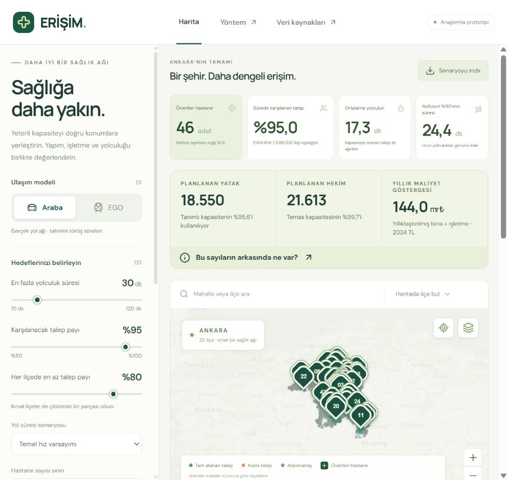

# ERİŞİM · Ankara Hastane Yerleşim Laboratuvarı

Ankara’nın **25 ilçesinde**, **yatak, hekim, yıllık hasta talebi, bina yatırımı, işletme gideri ve ağ üzerinden yolculuk süresini** birlikte değerlendiren, harita üzerinde çalışan araştırma uygulaması.

Gerçek TÜİK mahalle nüfusları ve OpenStreetMap yol bağlantıları kullanılır. Mevcut binalar aday konumları engellemez; örnek yapı alanları karayolu ve yüzey demiryolu koridorlarının dışında seçilir. Mevcut hastaneler yeni yerleşimi kısıtlamaz; yalnızca ayrı bir erişim karşılaştırması sağlar.

> **Veri düzeyi:** Araba modu yönlü yol ağında tahmini süre hesaplar. EGO modu **resmî kalkış listelerini ve durak sırasını** kullanır; ara durak süreleri OSM ağıyla tahmin edilir. Hafta içi 08.00/10.00, cumartesi/pazar 10.00 ayrı değerlendirilir. Özel sefer notları, takvim ve yol bağlantısı eksikleri nedeniyle kapsam kısmidir; gerçek kent için kesin ihtiyaç sayısı vermez. Kapasite hesabı resmî il toplamlarından türetilen talep ve açık tesis/iş yükü varsayımları kullanır. TL tutarları yaklaşık Aralık 2024 sabit fiyatlarıdır. MLP giderlerinden aktarılan işletme proxy tutarları kamu hastanesi maliyeti ölçümü değildir; cihaz, arsa ve dış altyapı yatırımı hariçtir.



## Kullanım

1. **Araba / EGO** modunu seçin. EGO için normal gün türünü ve yolculuğa başlama saatini seçin.
2. En fazla yolculuk süresini, Ankara genelinde karşılanacak talep payını ve her ilçenin talep tabanını ayarlayın.
3. **Hastane sayısı sınırı** ile en fazla 91 tesis deneyini seçin. **Kapasite ve bütçe varsayımları** bölümünde talep çarpanı, doluluk, hekim iş yükü ve daha kısa yol için ek bütçeyi seçin. **Yerleşimi hesapla** düğmesine basın. İlk açılışta araba senaryosu otomatik hesaplanır.
4. Bir mahalleyi arayıp seçerek talebin hangi tesislere ne kadar payla atandığını ve her payın ağ güzergâhını görün.
5. İlçe sonuçlarını açın, mevcut hastaneleri katman menüsünden gösterin veya senaryoyu kaynaklarıyla birlikte JSON olarak indirin.

Arayüz Türkçedir; kaynaklar, model açıklaması, veri açıkları ve çözümün optimalite durumu uygulamanın içindedir. Parametre değiştirildiğinde eski sonuç açıkça işaretlenir ve yeniden hesaplanana kadar dışa aktarma kapatılır.

## Yerel kurulum

Python **3.12** ve Node.js **22 veya 24** gerekir. Hazırlanmış veri dosyaları repoya dahildir; uygulamayı çalıştırmak için Türkiye harita verisini yeniden indirmek gerekmez. Harita altlığı ve web yazı tipleri internet kullanır; ağ matrisi ve optimizasyon yerel çalışır.

```powershell
git clone https://github.com/ahmedberatAI/Ankara-Hastane-Yerlestirme.git
cd Ankara-Hastane-Yerlestirme
py -3.12 -m venv .venv
.venv\Scripts\python.exe -m pip install -r requirements.txt
npm ci
npm run build
.venv\Scripts\python.exe -m uvicorn backend.main:app --host 127.0.0.1 --port 8000
```

**Uygulama:** <http://127.0.0.1:8000> · **API belgesi:** <http://127.0.0.1:8000/docs>

macOS/Linux için `python3.12 -m venv .venv` ve `.venv/bin/python` kullanın. Geliştirme sırasında Python sunucusuna ek olarak ikinci terminalde `npm run dev` çalıştırın; Vite `/api` isteklerini 8000 portuna yönlendirir. `npm run preview` tek başına Python servisini başlatmaz.

Tek komutla hazırlanmış yerel sürümü başlatmak için: `npm start` (önceden kurulmuş `.venv` ve `dist` gerekir).

## Hangi veri gerçekten kullanılıyor?

| Katman             | Kaynak ve sürüm                                                                                          | Bu sürümde durum                                                       |
| ------------------ | -------------------------------------------------------------------------------------------------------- | ---------------------------------------------------------------------- |
| Nüfus              | [TÜİK ADNKS 2025](https://www.tuik.gov.tr/media/announcements/2025ADNKS_FavoriTablolar.xlsx), 31.12.2025 | 5.910.320 kişi; yayımlanan 1.427 mahalle                               |
| Mahalle konumu     | OSM adları + ilçe poligonları                                                                            | 1.413 mahalle, 5.889.804 kişi konumlandırıldı                          |
| Karayolu / yürüyüş | [Geofabrik Türkiye OSM kesiti](https://download.geofabrik.de/europe/turkey.html), 20.10.2026             | 1.303.779 düğüm, 1.864.240 yönlü sürüş kenarı                          |
| Toplu taşıma | EGO resmî kalkış/durak listeleri + Başkentkart koordinatları + OSM yolları/rayları | 665 yön/varyant araştırıldı; 430 ağa bağlandı; 10.743 resmî otobüs koordinatı; ara durak süreleri tahmini |
| Mevcut hastaneler  | OSM `hospital` kayıtları                                                                                 | 124 kayıt; resmî ve eksiksiz hastane listesi değildir                  |
| Talep / kapasite   | Sağlık Bakanlığı 2024 yıllığı                                                                            | Ankara başvuru/yatış/yatak/hekim tabloları; mahalleye orantılı dağıtım |
| Kalibrasyon / gider | Ankara Üniversitesi ve MLP 2024 faaliyet raporları, Etlik resmî tanıtımı, 2024 yapı tebliği | Gerçek ölçek ve hizmet örnekleri; bağımsız kadro, açık işletme proxy tutarları |

Konumu bilinmeyen **20.516 kişi paydadan çıkarılmaz**. Bu kişilere erişim kanıtlanmış sayılmaz. Dolayısıyla modelin kapsama oranı, yalnız eşleşen nüfusa bölünerek yapay biçimde yükseltilmez.

## Model neyi optimize ediyor?

Her adayda bir **50 / 150 / 300 / 600 / 1.000 / 2.000 / 4.050 yataklı** tesis seçilebilir. **Hekim sayısı ayrıca seçilen bir tam sayıdır; sabit hekim/yatak oranı yoktur.** Temas (başvuru + yatış) hekim kapasitesine, yatış günü yatak kapasitesine sığar. Hekim çalışma alanı da inşa edilir ve adayın yol dışı yapı izine sığmalıdır.

Önce **yıllıklaştırılmış bina yatırımı + yıllık işletme gideri** azaltılır. Sonra aynı toplam talep, seçilen **%0–30 ek yıllık maliyet** içinde daha kısa yolculuğa atanır. 25 yıl ve %3 reel iskonto birer planlama varsayımıdır. Hastane sayısı bu maliyet hesabının sonucudur; minimum sayı iddiası değildir.

Başlangıç: araba **30 dk**, EGO **45 dk**, il hedefi **%95**, ilçe tabanı **%80**, doluluk tavanı **%80**, hekim başına **2.140 yıllık temas**. Son değer MLP 2024 portföyünün 7,0 milyon ziyareti / 3.272 yıl sonu hekiminden türetilen proxy orandır. **Klinik kapasite standardı, FTE ölçümü veya Ankara’ya tam kalibrasyon değildir.** Ankara Üniversitesi örneklerinin 835 oranı ve işletme maliyeti çarpanı duyarlılık seçenekleridir. [Kaynak, hesap ve sınırlar](docs/capacity-research.md).

4.701 adayın 45/80/120/210 m yapı izleri yol/ray koridorları dışında doğrulanır. Hızlı kaynak modeli her mahallede her iz sınıfından en yakın 12 adayı kullanır. **91 testi için gerekli coğrafi alt sınır tüm adaylar ve tüm bağlantılarla** ayrıca hesaplanır; daraltılmış aramanın başarısızlığı imkânsızlık sayılmaz.

### 91 hastane deneyi

| Senaryo | Aynı %95 il / %80 ilçe hedefi | Sonuç |
|---|---|---|
| Araba, 30 dk, en fazla 91 | Sağlandı | 46 tesis · 18.550 yatak · 21.590 hekim · 17,32 dk |
| Hafta içi 08.00 · 45 dk · en fazla 91 | Bu modelde sağlanmıyor | Coğrafi alt sınır **165** |
| Hafta içi 10.00 · 45 dk · en fazla 91 | Bu modelde sağlanmıyor | Coğrafi alt sınır **167** |
| Cumartesi 10.00 · 45 dk · en fazla 91 | Bu modelde sağlanmıyor | Coğrafi alt sınır **170** |
| Pazar 10.00 · 45 dk · en fazla 91 | Bu modelde sağlanmıyor | Coğrafi alt sınır **168** |

Bunlar kaydedilmiş model sonuçlarıdır; minimum hastane ihtiyacı sayıları değildir. Araba/91 için ilk maliyet açıklığı %1,82, son plan maliyet açıklığı %1,77; her ikisi daraltılmış aday bağlantıları kapsamındadır. Eski 291 sınırı yalnız yürüyüş hatası düzeltilince 169'a iner. Yeni dört profilde coğrafi sınırlar 165–170 aralığında; eksik hizmet ve tahmini zamanlarla gerçek Ankara için kesin ihtiyaç çıkarılamaz. Resmî 2024 envanteri 85; 91 kullanıcı karşılaştırma eşiğidir. [Deney ve sınırlar](docs/transit-validation.md).

**Kapasiteyi ulaşım etkisinden ayıran kontrol:** ulaşım kısıtları kaldırıldığında kayıtlı 46 tesis / 18.550 yatak / 21.590 hekim planı, aynı %95/%80 hedeflerini ve EGO yıllık bütçesini sağlıyor. Böylece yüksek EGO sayısının yalnız toplam yatak ve hekim ihtiyacından doğmadığı görülebiliyor. Bu, gerçek EGO hizmetiyle 91 tesisin yeterliliğini veya minimum sayıyı kanıtlamıyor. [Tanı, yeniden hesaplama ve sınırlar](docs/transport-relaxation.md).

Yeni arayüz ilk maliyet planı ile son planı ayrı gösterir. Ayrıca kayıtlı 261 tesisli EGO planını **aynı konum, yatak, hekim ve yıllık bütçeyle dört profilde** sınar; başarısız profil gizlenmez. Küçük tesis kullanımı, kırsal erişim ve 24 süre/ilçe duyarlılığı da sunulur. [Kapasite ve dayanıklılık sonuçları](docs/validation.md), [bağımsız hakem döngüsü](docs/nightly-review.md).

Yeni ortak kapasite deneyi aynı konum ve yapı izlerinde yatak/hekim sayısını dört profil için birlikte yeniden seçer. Ayrıca bütçeyi kaldırıp alanların izin verdiği en yüksek kapasiteyi hesaplar. Böylece yalnız kaynak satın almanın yeterli olup olmadığı ayrı sınanır; yeni hastane yerleşimiyle karıştırılmaz. [Dar sefer kanıtları ve kalan veri açıklıkları](docs/service-evidence.md).

**Konumlar da dört profil için birlikte seçildiğinde**, doğrulanmış yeni örnek 209 konum / 26.400 yatak / 23.035 hekimle aynı %95/%80/45 dakika hedeflerini sağlıyor. Yıllık eşdeğer maliyet 175,868 milyar TL; önceki model tavanının %7,22 altında. Yıllık talep bir kez sayılıyor. Bu, mevcut modelde uygun bir ortak plan bulunduğunu gösterir; minimum sayı, aynı kişilerin dört profilde %95 kapsamı veya gerçek EGO yeterliliği değildir. Arayüzde ayrı haritası ve bağımsız yeniden hesaplanan kanıtı bulunur. [Ortak yerleşim: hesap ve sınırlar](docs/joint-plan.md).

Bu kaynaklar sabit tutularak yapılan ayrı süre aşaması, dört profilin ortalamasını **31,69→28,14 / 32,37→29,12 / 32,43→30,40 / 32,82→31,08 dakika** olarak iyileştiriyor. Aynı yatak, hekim, maliyet ve %95/%80/45 dakika hedefleri korunuyor. Hizmet alan mahalle payları değişebilir; herkesin yolculuğunun kısaldığı iddia edilmiyor. Sabit kaynaklara ait süre alt sınırları bağımsız kesir hesabıyla doğrulanıyor. [Süre aşaması ve kanıtın kapsamı](docs/joint-travel.md).

## Araştırma ve teknik belgeler

- [EGO kaynak araştırması ve tarifeli model](docs/transit-research.md)
- [EGO 291/91 karşılaştırması](docs/transit-validation.md)
- [Dört profil için aynı konum, yatak ve hekim: doğrulanmış ortak plan](docs/joint-plan.md)
- [Aynı kaynak ve maliyetle daha kısa yolculuk: bağımsız süre kanıtı](docs/joint-travel.md)
- [Ulaşım kaldırıldığında 91 sınırı: bağımsız kaynak ve bütçe tanığı](docs/transport-relaxation.md)
- [Kapasite ve ulaşım tanısı: arayüz kontrolü](docs/screenshots/kapasite-ulasim-tanisi.png)
- [Durak–yol yön eşleştirmesi ve bağımsız denetimi](docs/bus-stop-matching.md)
- [Başkentray: doğrulanan tarife ve henüz çözülemeyen peron erişimi](docs/baskentray-research.md)
- [v0.7: aynı yapı izlerinde kaynak artırımı ve dört profil kapasite tavanı](docs/screenshots/ego-ortak-kapasite-v07.png)
- [Tarihsel v0.5: gün/saat seçimi ve biniş saatli rota ekranı](docs/screenshots/ego-tarife-v05.png)
- [Tarihsel v0.5: aynı planın dört profilde kapasite ve bütçe testi](docs/screenshots/ego-dayaniklilik.png)
- [Veri kaynakları araştırması ve eksik veri planı](docs/research.md)
- [Yatak, hekim, talep ve maliyet araştırması](docs/capacity-research.md)
- [2025 sağlık bülteninin kapsamı ve Ankara kalibrasyonu](docs/health-data-freshness.md)
- [Matematiksel model, ulaşım varsayımları ve sınırlar](docs/methodology.md)
- [Veri sözlüğü, köken ve yeniden üretim](data/README.md)
- [Hesaplanmış örnek senaryolar ve doğrulama](docs/validation.md)
- [Makine tarafından okunabilen kaynak kataloğu](docs/sources.json)
- [Veri kalite raporu](data/processed/quality-report.json)
- [Kaynak ve çıktı dosyalarının SHA-256 manifestosu](data/processed/manifest.json)

## Kontroller

```powershell
.venv\Scripts\python.exe -m pytest -q
npm run build
.venv\Scripts\python.exe scripts/verify_release.py
.venv\Scripts\python.exe scripts/verify_transit.py
.venv\Scripts\python.exe scripts/audit_robustness.py
.venv\Scripts\python.exe scripts/audit_shared_capacity.py
.venv\Scripts\python.exe scripts/audit_transport_relaxation.py
```

Testler bağımsız yer/kadro seçimini küçük örneklerde tam sayım ve akış LP’siyle karşılaştırır; yatak ve hekim darboğazlarını, bölünmüş talebi, bütçe/süre tercihini, ilçe tabanlarını ve bilinmeyen nüfusu denetler. `verify_release.py`, kaydedilmiş araba ve dört EGO profili senaryolarındaki bütün atamaları, alanı, iki kaynağı ve yıllık maliyeti bağımsız hesaplar; 91 için tam coğrafi alt sınırı ve büyük alanların ağ rotalarını doğrular. `--write-examples` yeni çözümler üretir. `scripts/verify_transit.py` dört profilin kalkış, aktarma ve matris tutarlılığını kontrol eder. Ham OSM varsa `scripts/audit_data.py` yol/ray koridorlarını ayrıca denetler.

Yeni senaryo yaklaşık 1–3 dakika sürebilir. Kapasite/maliyet için geçerli başlangıç oluşturulur, ardından her iki MILP aşaması 35'er saniye çalışır. Aynı süreçte aynı parametreler bellekte önbelleğe alınır. Arayüz, ilk ve son planın ayrı maliyet açıklıklarını, daraltılmış arama kapsamını ve bütçe/süre değişimini gösterir. [Doğrulama sonuçları](docs/validation.md).

## Yapı ve dağıtım

```text
src/                  React + TypeScript + Leaflet arayüz
backend/              FastAPI, yönlendirme, HiGHS kapasiteli optimizasyonu
scripts/              İndirme, OSM çıkarımı, ağ/matris üretimi, denetim
data/processed/       Sürümlenmiş nüfus, coğrafya, ağ ve süre matrisleri
docs/                 Kaynak araştırması, yöntem, doğrulama
tests/                Optimizasyon ve API testleri
```

FastAPI derlenmiş React arayüzünü de sunar. Python işlemi gerektiği için uygulama **GitHub Pages üzerinde tek başına çalışmaz**. Sunuculu dağıtım için Node derlemesini ve Python servisini içeren `Dockerfile` hazırdır; Docker ile çalıştırma bu geliştirme ortamında doğrulanmadı. İlk sürüm yerel/tek kullanıcı kullanımına yöneliktir; internete açık çok kullanıcılı kullanım öncesinde iş kuyruğu, istek sınırı ve kalıcı sonuç önbelleği eklenmelidir.

## Veri atfı

Nüfus: **TÜİK, ADNKS 2025** — [yeniden kullanım koşulları](https://www.tuik.gov.tr/Kurumsal/Yasal_Uyari).

Harita, yollar ve OSM kaynaklı türetilmiş veri: **© OpenStreetMap contributors**, [ODbL 1.0](https://www.openstreetmap.org/copyright). Türetilmiş veri dosyaları bu koşullarla paylaşılır; bu atıf üçüncü taraf verinin sahipliğini değiştirmez. Kod için ayrıca bir açık kaynak lisansı seçilmemiştir. [Veri atıf ve lisans notları](data/NOTICE.md).
