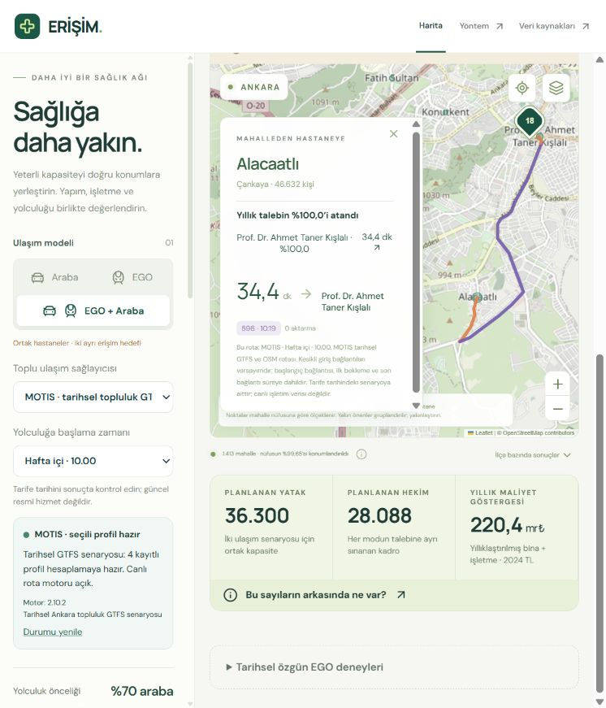

# MOTIS ve hibrit sürümün kayıtlı doğrulaması

26 Ekim 2026 geliştirme çalışması. Deney tarihi hafta içi 27 Ekim 2026 10.00 TSİ; diğer hazır profiller 27 Ekim 08.00, 31 Ekim 10.00 ve 1 Kasım 10.00'dır. Bu, kullanıcının kabul ettiği **tarihsel topluluk GTFS senaryosudur**. Güncel resmî EGO hizmeti veya ambulans seyahat süresi doğrulaması değildir.

## Yeni kayıtlı sonuçlar

Her modda il hedefi %95, her ilçe tabanı %80; araba 30, toplu taşıma 45 dakika. Konumu bilinmeyen nüfus paydada kalır. Hekim iş yükü 2.140 yıllık temas, yatak doluluk tavanı %80; açık kapasite ve işletme proxy varsayımları korunur.

| Kayıt | Hastane | Yatak | Hekim | Yıllık eşdeğer maliyet | Ortalama süre |
|---|---:|---:|---:|---:|---|
| MOTIS, yalnız toplu taşıma | 214 | 25.300 | 23.076 | 174,085 milyar TL | 29,66 dk |
| EGO + Araba, ortak kaynaklar | 326 | 36.300 | 28.088 | 220,413 milyar TL | araba 14,77; EGO 33,21; %70/%30 ağırlıklı 20,30 dk |

Hibrit il kapsamı iki modda da %95'tir. En düşük ilçe kapsamı arabada %80,4071, EGO'da %80,0478'dir. Aynı kişilerin iki modda da kapsanması ayrıca zorunlu tutulmaz. İki alternatif tam talep senaryosunun kapasitesi ayrı sınanır, yıllık fatura bir kez sayılır. %70/%30, ulaşım amaç fonksiyonunun tercihidir; gerçek hasta veya ambulans kullanım payı değildir.

**326 minimum hastane sayısı değildir.** 90 saniyelik sınırlı aramada doğrulanmış bir başlangıç çözümü korunmuştur. Bu kayıtta süre aşaması ilk plandan daha kısa bir geçerli çözüm bulamamıştır. İlk/son maliyet 220,413 milyar TL, %10 ek bütçe tavanı 242,454 milyar TL'dir. Son planın maliyet açıklığı %23,16; ağırlıklı süre açıklığı %72,65'tir. Bu açıklıklar daraltılmış bağlantı grafiğinde native çözücünün alt sınırlarına göredir; daha iyi çözüm bulunabileceğini gösterir, küresel optimum kanıtı değildir. Arayüz bu sınırları maliyet ayrıntısında gösterir.

Kapasite ve ilçe denetimi; iki moddaki pozitif atamaları, tam nüfus paydalarını, bağımsız yatak/hekim tam sayılarını, orijinal kadro üst sınırlarını, alanı, çakışan yapı izlerini ve tek yıllık malzeme faturasını yeniden hesaplar. İlk maliyet aşamasının optimalitesini veya native alt sınırların bağımsız matematiksel ispatını ürettiği iddia edilmez.

## 91 sınırı yeniden denendi

[Yeni rapor](../data/processed/motis-91-results.json), dört ayrı MOTIS profili ve hafta içi 10.00 hibrit için beş deneme içerir. Beşinde de süre sınırlı/daraltılmış aramada doğrulanmış bir 91 tesis planı bulunamadı: durum **sonuçsuz (`inconclusive`)**. Hedefler gevşetilmedi. Bu, 91 tesisin yeterliliğini veya bütün adaylar/gerçek Ankara için yetersizliğini kanıtlamaz. Sorgulanmamış çiftler hizmet yokluğu sayılmaz. Önceki 165–170 sınırları özgün EGO modeline aittir; yeni MOTIS için aktarılmadı.

## Rota ve kaynak kanıtı

MOTIS paketi: `motis-8bbee1c73c4bee6a43a73b253e46febbf5cc0619f7a6e57a55fbfd2cd5cb6719`. Dört profil için 135.610 ayrıntılı yerel `/plan` sorgusu yapıldı; sağlayıcı/bulk hata sayısı sıfırdı. Sıfır HTTP hatası, tarifenin gerçek hayatta doğru olduğu anlamına gelmez. Nihai süreler deneysel toplu uç noktadan alınmaz; o uç nokta yalnız kısa liste önerir.

[Sekiz ham rota kaydı](../data/processed/motis/route-checks.json), her profilde bir doğrudan yürüyüş ve bir toplu taşıma örneğini içerir. Kayıtlar aynı başlangıç noktasından gelir; toplu taşıma örnekleri 45 dakikanın dışındadır. Dolayısıyla bu sekiz kayıt yalnız zaman/bağlantı aritmetiğini ve paket tutarlılığını sınar. Bağımsız Decimal hesabında başlangıç bağlantısı, dakika tavanı, bekleme, bütün ayaklar ve son bağlantı tekrar toplandı; en büyük matris farkı 0,00000254 dakikadır.

Ek olarak **ALACAATLI → H-1886 / Prof. Dr. Ahmet Taner Kışlalı** ataması, **596 hattıyla 34,4 dakika** olarak canlı yerel uygulama API'sinden yeniden alındı. Bu rota gerçekten kayıtlı hibrit atamasına bağlıdır ve 45 dakika içindedir. [İstek, güzergâh, plan hash'i ve motor kimliği](../data/processed/motis/assigned-route-check.json) ayrı saklanır. Bu tek örnek bütün atamaların sahada doğrulandığı anlamına gelmez.

Paket ve kod kimliği her MOTIS isteğinde doğrulanır. Yerleşim A paketinden, rota B paketinden gelirse reddedilir. Rota sorgusu öncesi/sonrası paket eşitliği kontrol edilir. İşletim sistemi üzerinden dinleyen PID, süreç başlangıcı, motor dosyası, çalışma dizini ve etkin `--data data` argümanı da doğrulanır. Motor kapalıyken kayıtlı matris hesabı kullanılabilir; yeni MOTIS güzergâhı motor gerektirir. Ücretli sağlayıcıya geçiş yapılmaz.

## Bağımsız hakemlerin kabul kapsamı

- **Ulaşım hakemi:** dört matrisin kaynak/kimlik/maskeleri, sekiz ham rotanın bağımsız zaman hesabı, hibrit atamaların bütün matris hücreleri, 34,4 dakikalık atanmış örnek ve beş sonuçsuz 91 kaydının dürüst kapsamı kabul edildi.
- **Optimizasyon hakemi:** iki tam talep akışı/ortak kaynak/tek fatura formülasyonu; kaynak ve PID değişimi kapıları; son planın fiziksel akış, alan, kadro ve bütçe denetimi kabul edildi. İncelemede bulunan ilçe yüzde toleransı ve hekim üst sınırı eksikleri karşıörneklerle giderildi.
- **Veri ve arayüz hakemi:** ayrı mod sonuçları, kaynak ve senaryo eşliği, eski sonuçların ayrılması, bilinmeyen/olanaksızlık ayrımı ve eski paketle yeni rota gösterilmesini engelleyen kontroller kabul edildi. Görsel son kontrol ana ajan tarafından ayrıca yapıldı.

Kabul, tarihsel veri ve belirtilen arama kapsamıyla sınırlıdır. Güncel EGO tarifesi, klinik kadro standardı, kamu hastanesi maliyet kalibrasyonu, gerçek ambulans süreleri ve küresel optimum bu kabulün parçası değildir.

## Yeniden çalıştırma

Son yerel kapıda **1.331 test geçti**, platforma bağlı 5 test atlandı. On arayüz kontrol dosyası (hibrit için 48 kontrol), üretim derlemesi, yeni MOTIS/hibrit doğrulayıcıları ve önceki sürümün yayın, EGO ağı, dayanıklılık, ortak kapasite, ulaşım gevşetmesi, ortak plan/süre, giriş bağlantısı ve 44 başlangıç saati denetimleri geçti. Tarayıcıda iki görünüm, 34,4 dakikalık 596 rotası ve kartın yolu kapatmaması kontrol edildi; hata konsolu boştu. Bu yerel kontroller GitHub Actions sonucunun ayrıca gözlendiği anlamına gelmez.



```powershell
.venv\Scripts\python.exe -m pytest -q tests
npm run build
.venv\Scripts\python.exe scripts/verify_motis.py
.venv\Scripts\python.exe scripts/verify_hybrid.py
.venv\Scripts\python.exe scripts/manifest.py --check
node tests/hybrid_ui.mjs
```

İlk MOTIS matrislerini yeniden üretmek için yerel motor/veri kurulu olmalıdır: `scripts/build_motis_matrices.py --write --profiles weekday-1000 weekday-0800 saturday-1000 sunday-1000`. Ardından `scripts/verify_motis.py --capture-live` ve `scripts/run_hybrid_demo.py --write` yeni kayıtları üretir. Kaynak veya model değiştiğinde eski kayıtlar sessizce yeniden etiketlenmez.
