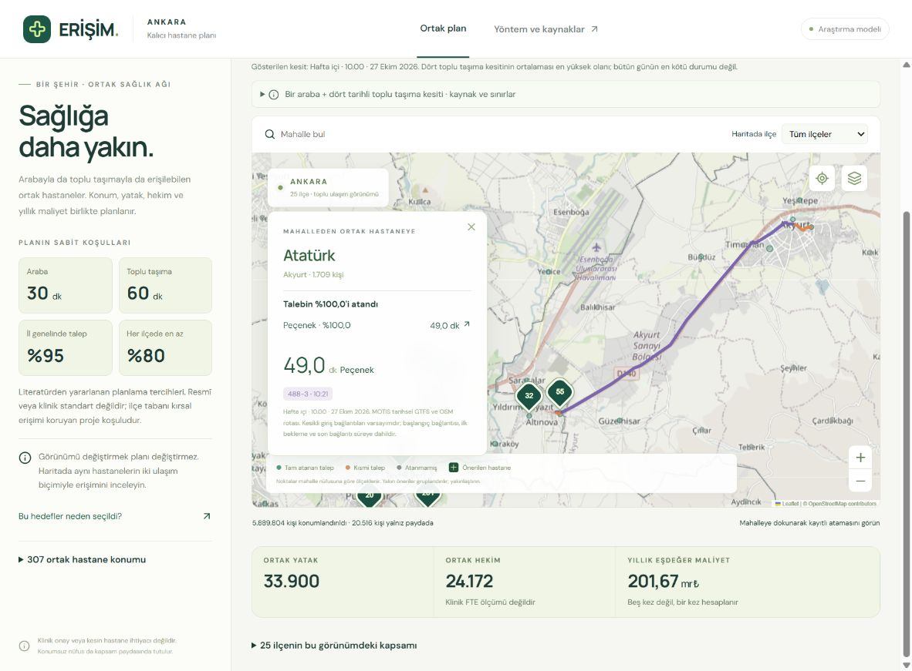

# Tek kalıcı hastane yerleşimi

27 Ekim 2026. Güncel ana uygulama aynı hastane konumlarını, yatakları ve hekimleri araba ve dört tarihli toplu taşıma kesiti için birlikte seçer. Görünüm değişikliği yeniden hesaplama yapmaz. Tesis sayısı, trafik senaryosu ve yolculuğa başlangıç saati formdan kaldırılmıştır.

## Sabit politika

[Sürümlenmiş politika](../data/planning-policy.json): araba 30 dakika, toplu taşıma 60 dakika, her kesitte %95 il ve her ilçede en az %80 talep. [Birincil literatür ve uygulanabilirlik](planning-standards.md) sayıların gerekçesini açıklar. Bunlar evrensel veya klinik standart değildir. %80 ilçe tabanı korunmuş proje eşitlik koşuludur; WHO'nun cerrahi erişim hedefinden aktarılmaz.

Değerlendirme kümesi: sabit araba ağı; 27 Ekim 2026 08.00 ve 10.00; 31 Ekim 10.00; 1 Kasım 10.00 TSİ MOTIS kesitleri. Tarihler veri kesitinin kimliğidir, kullanıcı tarafından seçilen yerleşim senaryoları değildir. Dört tarihli örnek, bütün saatler veya gerçek güncel EGO tarifesi için garanti oluşturmaz. Önceki 44 başlangıç saatli sonuç özgün EGO modeline aittir; yeni MOTIS sonucu için yeniden adlandırılmaz.

## Ortak karar ve ayrı erişim akışları

Her adayda yatak tipi ve bağımsız tam sayı hekim seçilir. Beş kesitin mahalle–hastane talep akışları ayrıdır; her kesitte aynı tam yıllık talep temel alınır. İl kapsamı tam `%95 × 5.910.320 = 5.614.804` kişi eşdeğeridir. Her ilçenin resmî nüfusuna göre %80 tabanı ayrıca korunur. Farklı kesitlerde aynı bireylerin kapsanması zorunlu değildir.

Her tesiste her kesitin temas yükü hekim kapasitesine; yatış günü yükü yatak kapasitesine sığar. Kesitler alternatif erişim koşullarıdır: yükleri birbirine eklenmez, kaynak her birine yeterli olur. Alan ve yapı izi çakışmaları aynı ortak yerleşimde denetlenir. Konumsuz 20.516 kişi paydada kalır ve erişilmiş sayılmaz.

Önce yıllıklaştırılmış inşaat + yıllık işletme gideri azaltılır. Bulunan geçerli referans maliyetin %10 ek bütçesi altında, %70 araba + dört toplu taşıma kesitinin her birine %7,5 ağırlıkla yolculuk süresi azaltılır. Bütün kesitlerde erişim ve kapasite koşulları sert kısıttır; %30 toplu taşıma ağırlığı bu hedefi azaltmaz. %70 öncelik gerçek ambulans kullanım payı değildir ve ambulans için hız avantajı verilmez.

Yıllık sabit, yatak ve hekim giderleri ortak kaynaklar üzerinden bir kez hesaplanır. Her kesitte aynı homojen talep karşılandığı için malzeme gideri de bir kez eklenir. Tesis bazlı malzeme dağılımı araba atamasını muhasebe bölüşümü olarak kullanır; kesitler arası azami tesis yüklerini toplayarak il malzeme gideri şişirilmez. İnşaat 25 yıl ve %3 reel iskonto ile yıllıklaştırılır.

2.140 temas/hekim/yıl özel hastane grubu oranından aktarılan proxy'dir; klinik kapasite veya FTE standardı değildir. %80 yatak doluluk tavanı planlama varsayımıdır. İşletme giderleri kamu hastanesi maliyet kalibrasyonu değildir. Tutarlar yaklaşık Aralık 2024 TL; arsa, cihaz ve dış altyapı yatırımı hariçtir. [Kapasite ve gider kaynakları](capacity-research.md).

## Arama ve denetim kapsamı

4.701 adayın tamamı yerleşim havuzundadır. Araba akışları mahalle ve yapı izi sınıfı başına en yakın 12 süre içi adayla sınırlandırılır. Toplu taşıma için hazırlanmış MOTIS matrislerinin süre içindeki bütün bilinen bağlantıları tutulur. Bu matrisler de sorgulanmış kısa listeden oluşur; sorgulanmamış çiftler gerçek hizmet yokluğu sayılmaz. Adaylar şehirdeki her olası koordinat değildir.

Süre sınırlı maliyet ve yolculuk araması, doğrulanmış başlangıç planını güvenli geri dönüş olarak korur. İlk ve son kaynaklarda sabit kaynaklı akış LP'leri uygulanabilir. Son yükler sabitken yatak/hekim temizliği yapılır; akış kırpılarak hedef sağlanmış gibi gösterilmez. Kaydedilen maliyet/süre açıklıkları çözücünün daraltılmış problem alt sınırlarınadır. Referansın küresel en düşük maliyet veya hastane sayısının asgari ihtiyaç olduğu iddia edilmez.

`scripts/verify_permanent.py` yerleştirme çözücüsünü çalıştırmadan beş atamayı özgün matris hücreleriyle, kişi ve ilçe paydalarıyla, ayrı yatak/hekim kapasiteleriyle, alan/çakışmayla ve tek yıllık maliyetle yeniden hesaplar. Ham ortak sertifika, API/harita atamaları, kritik profil ve kaynak kimliği eşleştirilir. Bu denetim native alt sınırların bağımsız ispatını veya ilk maliyet aşamasının geçmişini yeniden üretmez.

## Kayıt ve arayüz

[Kaydedilmiş ortak plan](../data/processed/permanent-plan.json), politika, model ve veri SHA-256 kimliklerine bağlıdır. `GET /api/permanent-plan` kaydı doğrular; hesap başlatmaz. Araba/toplu taşıma sekmeleri aynı `selected` konum ve kapasite kaydını kullanır. Toplu taşıma haritası dört tam kesitten nüfusla ağırlıklı ortalaması en yüksek olan tek kesiti gösterir; mahalle bazında farklı saatleri birleştirmez. Eşitlik durumunda profil kimliği sırası belirleyicidir.

`POST /api/permanent-route` yalnız plan kimliği, görünüm, mahalle ve atanmış hastaneyi kabul eder. Pozitif atama, seçilmiş ortak konum, sabit politika, matrisle süre eşliği ve MOTIS kaynak kimliği kontrol edilir. İstek sırasında plan değişirse rota reddedilir. Güncel kayıt yoksa eski senaryo sessizce yerine geçirilmez.

## Kaydedilmiş sonuç ve hakem kabulü

Plan kimliği: `permanent-0f8f5be520f18d7963cfbf37c4e6e4c857a9dea0290bcdd2853b41b0adbf7369`.

**307 konum, 33.900 yatak, 24.172 hekim; yıllık eşdeğer maliyet 201,669 milyar TL.** Tek malzeme gideri 33,669 milyar TL'dir. Referans ve son maliyet aynıdır; bütçe tavanı 221,836 milyar TL. Beş kesitte de aynı kaynaklarla 5.614.804 kişi eşdeğeri atanır.

| Kesit | İl kapsamı | En düşük ilçe | Ortalama süre | En uzun pozitif atama |
| --- | ---: | ---: | ---: | ---: |
| Araba | %95 | %80 | 14,52 dk | 29,87 dk |
| Hafta içi 08.00 | %95 | %80 | 32,33 dk | 59,67 dk |
| Hafta içi 10.00 | %95 | %80 | 34,62 dk | 59,07 dk |
| Cumartesi 10.00 | %95 | %80 | 33,23 dk | 59,67 dk |
| Pazar 10.00 | %95 | %80 | 33,44 dk | 59,67 dk |

**307 konumun gerekli veya optimum olduğu kanıtlanmadı.** İki native aşama da süre sınırına ulaştı. Maliyet açıklığı %83,31, ağırlıklı süre açıklığı %100'dür; bu zayıf alt sınırlar iyi yakınsama iddiasına izin vermez. Yayınlanan çözüm doğrulanmış başlangıç, sabit kaynaklı akış ve kaynak temizliği üzerinden korunmuştur; referans ile final arasında anlamlı ek süre iyileşmesi bulunmadı. Daha iyi maliyet/yerleşim araması açık geliştirme önceliğidir. 257 tesis 50 yataklıdır; bunlar klinik ölçekte doğrulanmış ihtiyaç sayıları değildir.

Bağımsız ulaşım hakemi 4.671 pozitif akışın tamamını matrislerle, 3.469 toplu taşıma akışını sorgu maskeleriyle eşleştirdi. Optimizasyon hakemi ham ortak planı 258.962 değişkenli özgün modele geri yükledi: en büyük satır ihlali yaklaşık `2,73e-12`, tam sayı ihlali sıfır, maliyet farkı sıfır. Veri/arayüz hakemi gerçek JSON kaydını ve araba/toplu taşıma rota yanıtlarını arayüz kapılarından geçirdi. Üç kabulün kapsamı **bu veri, kaynak ve beş örnekteki uygulanabilirliktir**; optimum, bütün gün hizmet, gerçek Ankara yeterliliği veya klinik doğrulama değildir.

Yerel son test kapısında 1.503 test geçti, platforma bağlı 5 test atlandı; 93 kalıcı UI kontrolü ve üretim derlemesi geçti. Tarayıcıda sabit hedefler, iki görünümde aynı konum/kaynaklar, beş kesit tablosu, kapasite/maliyet açıklaması ve yüksek çözüm açıkları kontrol edildi. Akyurt Atatürk → Peçenek ataması, tarihsel MOTIS 488-3 hattıyla 49 dakika olarak haritada doğrulandı; araba örneği de API ve görünüm kapısından geçti. [İki gerçek API rota kaydı](../data/processed/permanent-route-checks.json) plan dosyasının hash'ine bağlıdır; arayüz testi bu kayıtları da zorunlu olarak denetler.



```powershell
.venv\Scripts\python.exe scripts/run_permanent_plan.py --write --seconds 180
.venv\Scripts\python.exe scripts/verify_permanent.py
.venv\Scripts\python.exe -m pytest -q tests
node tests/permanent_ui.mjs
npm run build
```

Hazır planın okunması için yerel MOTIS süreci gerekmez. Yeni toplu taşıma güzergâhı çizmek için aynı veriyle kurulmuş yerel motor gerekir. Ücretli API kullanılmaz.
